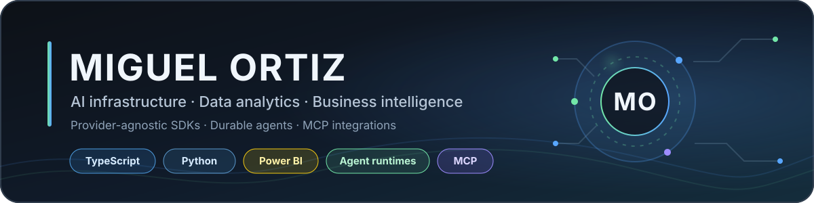

  

I build AI infrastructure in TypeScript and Python: multi-provider SDKs,
durable agent runtimes, and MCP integrations. My background in banking
analytics shapes how I approach data quality, traceability, and reliable systems.

I contribute to the [Zhivex](https://github.com/Zhivex) ecosystem, with public
work on agent safety, persistence, provider integrations, and release validation.

## Selected work

### [Zhivex AI SDK — TypeScript](https://github.com/Zhivex/zhivex-ai-sdk)

Build agents and AI applications around a shared model contract, with explicit
provider capabilities, tools, streaming, and durable execution.

**My contribution:** hardened retries, routing fallbacks, and agent generation
safety; added strict unknown-tool validation and recovery.
[Contribution](https://github.com/Zhivex/zhivex-ai-sdk/pull/90) ·
[Quickstart](https://github.com/Zhivex/zhivex-ai-sdk/blob/main/docs/QUICKSTART.md) ·
[Human approval example](https://github.com/Zhivex/zhivex-ai-sdk/blob/main/examples/agents/approval-hitl.ts) ·
[npm package](https://www.npmjs.com/package/@zhivex-ai/sdk)

### [Zhivex AI SDK — Python](https://github.com/Zhivex/zhivex-ai-sdk-py)

Build async agents with tools and a portable provider contract, then add durable
state, approvals, and observability as the application needs them.

**My contribution:** implemented durable onboarding and operational evidence,
including preservation of typed tool inputs when resuming after approval.
[Contribution](https://github.com/Zhivex/zhivex-ai-sdk-py/pull/41) ·
[Quickstart](https://github.com/Zhivex/zhivex-ai-sdk-py/blob/main/docs/QUICKSTART.md) ·
[Runnable agent](https://github.com/Zhivex/zhivex-ai-sdk-py/blob/main/examples/agents/quickstart_agent.py) ·
[PyPI package](https://pypi.org/project/zhivex-ai-sdk/)

### [MCP BCRA](https://github.com/mortiz-dev/mcp-bcra)

Connect agent tools to official APIs from Argentina's Central Bank. For example,
discover a public statistical series and retrieve its history with validated
inputs and structured responses.

**My contribution:** expanded BCRA API coverage and refactored the tools and shared
HTTP infrastructure.
[Contribution](https://github.com/mortiz-dev/mcp-bcra/commit/286095385fede60593989b588c021d70791ac5f7) ·
[Setup and tools](https://github.com/mortiz-dev/mcp-bcra#instalación-y-ejecución)

### [Service operations analytics — synthetic case study](./case-studies/service-operations/README.md)

A reproducible portfolio example connecting data quality checks, SQL, KPI
definitions, a visual summary, and Power BI modeling guidance.
**All data is synthetic.** This is a demonstration, not a client delivery or a
claim about a real bank's performance.

[View the analysis](./case-studies/service-operations/README.md) ·
[Dataset](./case-studies/service-operations/data.csv) ·
[SQL](./case-studies/service-operations/metrics.sql)

## Banking analytics & business intelligence

I have delivered data analysis and Power BI dashboards for teams in the banking
sector, covering data modeling, SQL, Power Query, DAX, KPI design, data quality,
and executive and operational reporting.

Client work remains confidential. The independent synthetic example above shows
an analytical approach without reproducing client datasets, dashboards, or metrics.

## Languages & tools

  

## Connect

Based in Buenos Aires, Argentina. I work in English and Spanish.

For conversations about AI infrastructure, SDK integrations, or data analytics,
connect with me on [LinkedIn](https://www.linkedin.com/in/mortiz94/) or
[X](https://x.com/mortiz_dev).

[Zhivex](https://www.zhivex.com) · [SDK documentation](https://sdk.zhivex.ai) ·
[Open-source projects](https://github.com/Zhivex)
