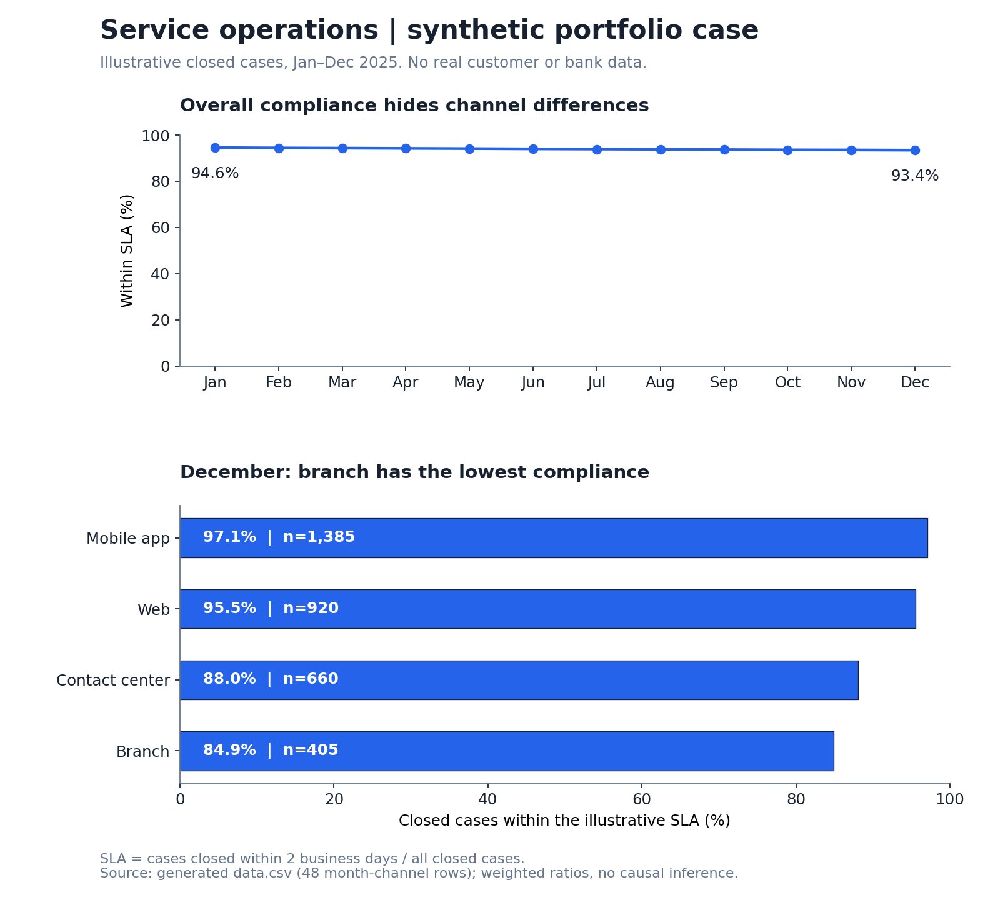

# Service operations analytics

**Synthetic portfolio demonstration — not a client project.** All records are
fabricated by [build.py](./build.py). The dates and values describe an illustrative
2025 scenario and do not represent any bank, customer, or production result.
This case contains a reproducible visual summary and a Power BI modeling recipe;
it does not include a Power BI workbook or claim to reproduce a client dashboard.

## Question

Where should an operations team investigate service-level differences when the
overall SLA indicator appears healthy?



In this scenario, December's overall compliance is **93.4%**, but branch compliance
is **84.9%** and contact-center compliance is **88.0%**. Mobile and web volume weighs
more heavily in the overall rate. A single aggregate would obscure that difference.

The next step would be to inspect case mix, workload, and processing delays in
those channels before choosing an intervention. These aggregates do not establish
a cause or quantify the impact of a staffing or process change.

## Data model and metric contract

- **Grain:** one row per closure month and service channel; 12 months × 4 channels.
- **Population:** cases closed during each month, assigned to one closing channel.
- **Closed cases:** denominator, including cases that missed the SLA.
- **Within SLA:** closed cases resolved within an illustrative two-business-day threshold.
- **Compliance:** `SUM(within_sla) / SUM(closed_cases)`. Channel percentages are never averaged.
- **Excluded:** open cases, backlog, customer identifiers, financial balances, and satisfaction.
- **Boundary:** the generator assigns aggregate SLA counts directly. It does not
  calculate business-day durations from raw timestamps or validate a holiday calendar.

The dataset is intentionally small and aggregated so the entire result can be
checked. It cannot support case-level distributions, backlog analysis, or causal claims.

## Reproduce and inspect

Use Python 3.11+ with the chart dependency in [requirements.txt](./requirements.txt):

```bash
python3 -m venv .venv
.venv/bin/python -m pip install -r requirements.txt
.venv/bin/python build.py
```

The script deterministically generates [data.csv](./data.csv), runs
[metrics.sql](./metrics.sql) in SQLite, exports [monthly-kpis.csv](./monthly-kpis.csv),
and renders the chart. It checks the 48 unique keys, positive denominators, valid
numerators, synthetic labels, and independently reconciles each SQL aggregate.

## Power BI implementation recipe

Import `data.csv` as `ServiceOperations` using Power Query. Set counts to whole
numbers, keep `month` as a year-month key, and build a month dimension with a
month-start date for chronological sorting. Add a channel dimension and relate
each dimension one-to-many to the fact table, with single-direction filtering.

```dax
Closed Cases = SUM(ServiceOperations[closed_cases])

Within SLA = SUM(ServiceOperations[within_sla])

SLA Compliance = DIVIDE([Within SLA], [Closed Cases])
```

Format `SLA Compliance` as a percentage. Use a monthly line chart for the weighted
rate and a channel bar chart filtered to December, with closed-case volume visible.
Add month and channel slicers. A missing denominator should remain blank rather
than being reported as 0% compliance.

## Visual design and limitations

The exported GitHub image compares 12 monthly weighted ratios and four channel
ratios for December. Both percentage axes run from 0 to 100. A single blue palette,
direct values, and visible denominators keep comparisons readable without relying
on color differences. The PNG is a static summary; filters belong to the Power BI
recipe and are not interactive in this repository.
