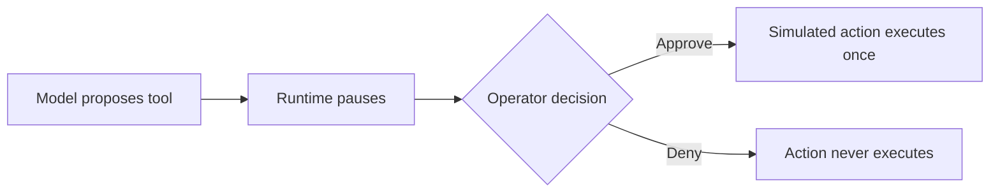

# Agent approval: propose, pause, decide

A small demonstration of the **real Zhivex agent runtime**, using a scripted
model and a simulated deployment. No API keys, provider calls, external services,
or real deployments are involved. Installing dependencies requires internet access.

The question: can a proposed tool action execute before the operator approves it?
The demo asserts that the answer is no, then checks approval and denial separately.

## Run it

Requires Bun 1.3.7 or newer. From a fresh checkout:

```bash
git clone https://github.com/mortiz-dev/mortiz-dev.git
cd mortiz-dev/demos/agent-approval
bun install --frozen-lockfile
bun run demo
```

Expected output:

```text
SCRIPTED MODEL · SIMULATED ACTION · NO NETWORK
WAITING: action proposed; executions=0
Choose: bun run demo --approve OR bun run demo --deny
```

Choose a decision:

```bash
bun run demo --approve
# WAITING: action proposed; executions=0
# APPROVED: executions=1
# Runtime status: completed

bun run demo --deny
# WAITING: action proposed; executions=0
# DENIED: executions=0
# Runtime status: completed
```

Each invocation starts a fresh scenario in memory. The flag supplies the operator's
decision; the script resumes the waiting state inside that invocation. It does not
persist or resume a previous process, deploy infrastructure, or implement an
authenticated approval UI. A completed run with a denied tool means the decision
was processed, not that the action executed.

## How it works

1. The scripted model proposes `deploy({ target: "staging" })`.
2. The tool requires approval in interrupt mode, so execution pauses.
3. The script verifies that there is one pending approval and zero executions.
4. The runtime resumes with the requested decision; the script checks exactly one
   execution for approval and zero for denial.



Run all three boundary checks:

```bash
bun test
```

The tests execute the pending, approved, and denied scenarios as separate
processes against the pinned published package and committed Bun lockfile.
They verify runtime behavior with a scripted model; they do not certify a live
provider or a production approval system.

## Source and next steps

[demo.ts](./demo.ts) is adapted from the SDK's
[approval example](https://github.com/Zhivex/zhivex-ai-sdk/blob/main/examples/agents/approval-hitl.ts),
under the included [MIT license](./LICENSE). It uses the public
`@zhivex-ai/agents` entry point and omits the example's Beta queue helper.

For persistent execution and application-owned approval controls, continue with
the [SDK agents guide](https://github.com/Zhivex/zhivex-ai-sdk/blob/main/docs/AGENTS.md).
